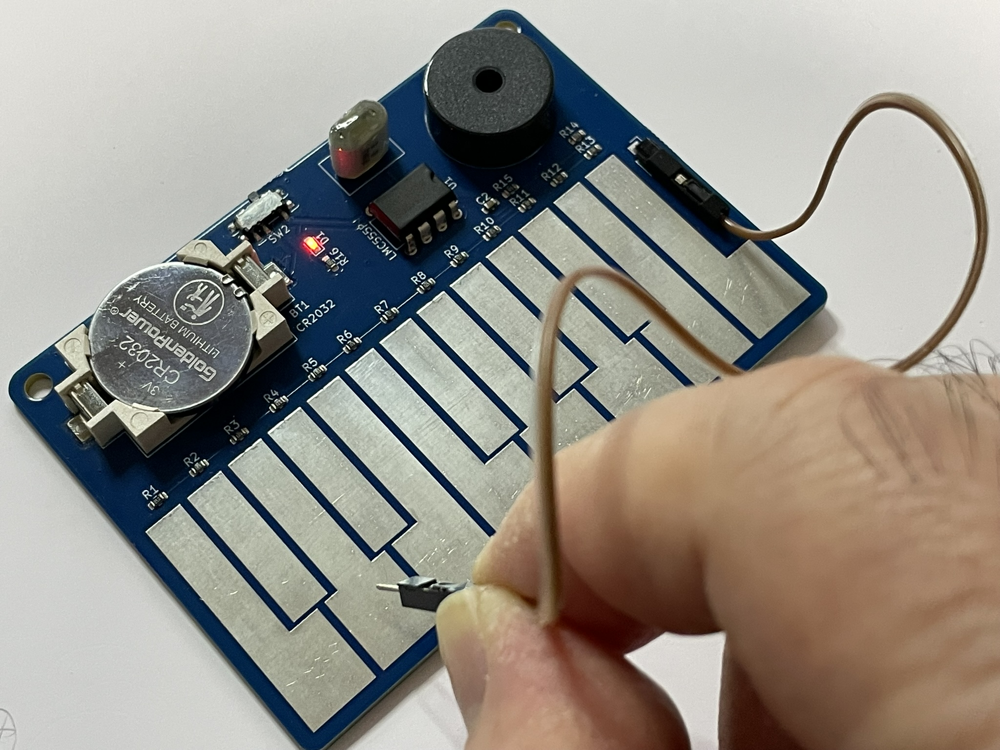

# Toy-Organ
Toy organ of single tone with CMOS 555

# おもちゃのオルガン
　オルガンの鍵盤に似せた電極をジャンパ線のピンで触ると音が出る、おもちゃのオルガンです。

  

### ねらい
　ハンダ付け体験（ハンズオン）教材を想定しており、できるだけシンプルかつ安価になることを狙っています。このハンズオンでは8pin DIP(Dual In-line Package)が目玉で、多数のピンを基板に挿入する体験をします。比較的大きいスルーホール部品の圧電スピーカーとフィルムコンデンサもハンズオンの対象としました。

### 工夫
　単音のため、スイッチを多数並べる代わりにオルガンの鍵盤に似せた電極をプリント基板上に形成しました。電極はフットプリントとして設計し、鉛フリーハンダでメッキ(HASL処理)しています。

### 回路
 - CMOS版タイマーIC 555を使用しています。コイン電池(CR2032)3Vで動作します。Texas Instruments(TI)社のLMC555のデータシートに代表的なアプリケーションの１つとして50%デューティ・サイクルの発振器があり、これを応用しました。発振周波数とRC回路定数の関係式から得られる値に近い抵抗値と容量値としました。精度±1%の抵抗(R1-14)、±5%のコンデンサ(C1)を選択しましたが、微調整機能はなく、素子の精度やバラつきで音程はかなり不正確と思います。  
- 電池の常時装着を想定し電源スイッチとパイロットLEDを設けました。光り具合を見て電流制限抵抗は3.3kΩ、消費電流は0.3mA程度としました。電力消費はCMOS版555より大きくなってしまいました。  
- スピーカーは圧電(Piezo)タイプです。低電圧でも、なんとか聞こえます。圧電スピーカーは衝撃を与えると発電します。パイロットLEDが一瞬点灯するのを観察できます。回路保護のため直列に1kΩの抵抗(R15)を、圧電スピーカーへの直流阻止のためコンデンサ(C2)入れました。圧電スピーカーは高インピーダンスのため回路定数への影響は少ないと思います。  
　スピーカーを555のDISCH端子に接続すると影響はさらに少なくなりますが、回路によっては電力消費が大きくなると思われます。例えば無音状態で出力端子は確率的にH/Lいずれかで停止する様です。DISCH端子を抵抗1kΩでプルアップして抵抗の両端の電圧で圧電スピーカーを駆動する回路だと、オン状態で停止した場合に電力消費が発生します。  
- ジャンパー線は一方がオス、もう一方がメスです。プリント基板上のピンヘッダー(オス)にジャンパー線のメス側を差し込み、オス側で鍵盤を触ります。

[回路図](./V01L02/bf-049b_sch.pdf)   

### 資料

[説明書](./V01L02/bf-049b_doc.pdf)  
[ちらし](./V01L02/おもちゃのオルガンB5.pdf)  